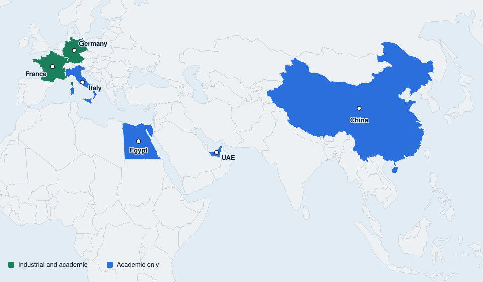

Industrial and academic collaborations across six countries.

<h2 class="pt-title">Partner institutions by country</h2>

France

Industrial + Academic

Industrial

<ul class="pt-list"><li>2CRSI</li><li>BDR Thermea Groupe</li><li>SOGEFI Air Cooling</li><li>Quiri Groupe</li><li>Ziemex S.A.S.</li><li>Wolfberger</li><li>Cave Vinicole d'Eguisheim</li><li>Geolith</li></ul>

Academic

<ul class="pt-list"><li>University of Strasbourg</li><li>INSA Strasbourg</li><li>Université Paris-Saclay</li></ul>

Germany

Industrial + Academic

Industrial

<ul class="pt-list"><li>Secon GmbH</li><li>Hyperheat GmbH</li></ul>

Academic

<ul class="pt-list"><li>HKA, Hochschule Karlsruhe</li></ul>

Italy

Academic only

Academic

<ul class="pt-list"><li>University of Milan</li><li>University of Padova</li></ul>

China

Academic only

Academic

<ul class="pt-list"><li>Harbin Institute of Technology</li><li>Shenzhen Institutes of Advanced Technology, Chinese Academy of Sciences</li><li>Southwest Jiaotong University</li><li>Southwest Petroleum University</li></ul>

United Arab Emirates

Academic only

Academic

<ul class="pt-list"><li>Khalifa University of Science and Technology</li></ul>

Egypt

Academic only

Academic

<ul class="pt-list"><li>Menoufia University</li></ul>

